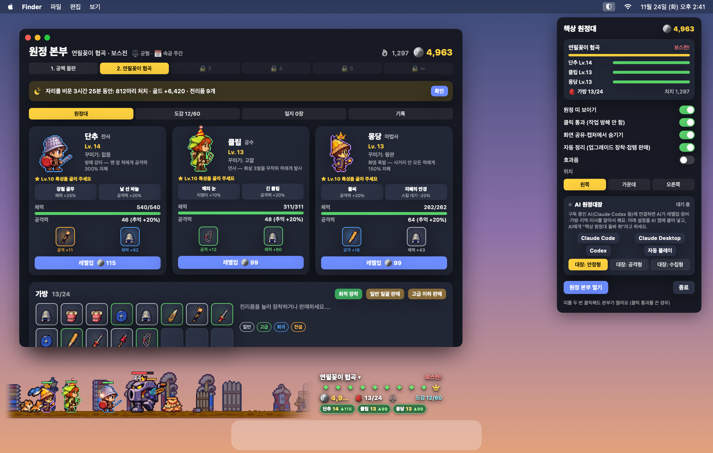

# STATUS — 책상 원정대 (DeskExpedition) MVP



## 완료한 것
- **MVP.md**: 기회 한 줄, 핵심 기능 5개, 이번에 뺀 것, 화면 목록, 수익 모델.
- **macOS 앱** (SwiftUI + AppKit, macOS 14+, 서드파티 의존성 없음, 번들 ID `club.lemongrove.deskexpedition`, App Sandbox 켬)
  - **원정 띠**: Dock 바로 위에 뜨는 투명 패널(920×80). 모든 데스크톱 공간에 표시되고 전체화면 앱 위에는 뜨지 않음. 클릭 통과 토글, 왼쪽/가운데/오른쪽 위치, 모니터 선택(2대 이상일 때).
  - **자동 전투**: 전사(방패 강타)·궁수(연사)·마법사(화염 폭발). 웨이브 10개마다 보스가 나오고, 보스를 잡으면 다음 지역이 열림(지역 5곳). 전멸하면 3웨이브 후퇴. 피해 숫자, 투사체, 피격 깜빡임 연출.
  - **장비**: 4등급(일반/고급/희귀/전설) 무기·방어구 드롭, 가방 24칸, 장착/교체/해제, 판매, 등급별 일괄 판매(업그레이드 장비는 남김), 최적 장착, 골드로 레벨업.
  - **메뉴바 팝오버**: 지역·웨이브, 파티 체력, 골드, 가방, 띠 설정, 원정 본부 열기.
  - **오프라인 정산**: 2분 넘게 자리를 비우면 최대 12시간을 0.5초 단위로 시뮬레이션하고 본부 배너와 띠 배너로 결과를 알림.
  - **알림**: 가방이 가득 차면 로컬 알림 1회(이후 새 전리품은 절반 값에 자동 판매).
  - **저전력**: 띠가 보일 때 10Hz, 가려지거나 숨겨지면 2Hz로 돌고 이펙트 계산을 생략.
  - **저장**: Application Support/DeskExpedition/save.json(샌드박스 컨테이너 안). 30초마다, 종료할 때 저장.
- **그래픽 리뉴얼 (v0.2 작업분, `ART.md`)**: 세계관을 "책상 위 미니어처 세계"로 바꿈. 영웅 단추(골무 투구 전사)·클립(포스트잇 궁수)·몽당(연필 모자 마법사), 지역 5곳(공책 들판 → 모니터 성채)과 몬스터 15종·보스 5종.
  - 아트: Codex CLI 이미지 생성(`scripts/art/gen.py`, 프롬프트는 `specs.py`) → `scripts/art/process.py`가 배경 제거·축소·팔레트 정리·발 기준 정렬 → `Resources/Art/`. 원본(`art/raw/`)은 커밋하지 않음.
  - 띠: 높이 100pt, SpriteKit으로 교체. 배경 2겹 패럴랙스 + 소품이 흐르고, 웨이브 사이 2.4초 동안 파티가 행군(걷기·점프), 적과 붙으면 멈춰 싸움. 몬스터는 엔진 위치를 부드럽게 따라감.
  - VFX(고해상도, 빛 더하기): 칼 궤적+섬광+불꽃, 화살 빛 꼬리+충격 고리, 화염구 충전→꼬리→폭발(링·불씨·연기), 스킬 오라, 치명타 금색 숫자, 히트스톱, 띠 안 흔들림, 처치 시 금빛이 HUD로 날아감, 전설 드롭 빛기둥, 레벨업 기둥.
  - 애착: 본부에서 이름 짓기, 머리 꾸미기 6종, 커서를 영웅 위에 올리면 손 흔들고 하트·이름 표시, 클릭 통과를 끄면 클릭해서 점프시키기.
  - 확인 도구: `--frames <dir>`로 띠를 0.1초 간격 PNG로 오프스크린 렌더링.
- **장기 목표 (0.2.2)**: 책상 도감 60칸(몬스터 20종 × 일반/반짝이 1/400/왕관 1/50, 보스는 일반·반짝이, 희귀 손님 5종), 칸마다 골드 +1%. 원정 일지 33장(영웅 이름이 들어간 짧은 일기). 서랍 심층(6번째 지역, 끝없는 층, 10층마다 보스의 메아리). 트로피 6종이 띠 풍경에 섞여 지나감. 이름 있는 전설 장비 20종(전설의 35%), 전설 무기 장착 시 손에 금빛. 이사(환생): 추억 조각 1개당 공격·골드 +5%, 책상 테마 4종(풍경 색조), 도감·일지·트로피·이름은 유지. 본부에 원정대/도감/일지/기록 탭.
- **배경 이음매**: 배경 띠를 반복할 때 양 끝을 가장 덜 달라지는 경로로 잇도록(이미지 퀼팅) 바꾸고, 공책·연필꽂이·서랍 배경은 가장자리에 큰 물체가 없도록 다시 생성.
- **공증 배포**: 릴리스는 집서버(이 Mac Studio)에서 `scripts/release.sh`로 올림. 테스트 → Developer ID 서명(서명용 키체인 `signing.keychain-db`) → 앱·dmg 공증(`weekwrap-notary` 프로필) → 스테이플 → 태그·GitHub 릴리스 업로드 → 내려받아 Gatekeeper 검증. GitHub Actions는 이제 테스트만(CI).
- **AI 원정대장 (0.2.5, `docs/AI.md`)**: 앱에 MCP 서버 내장(127.0.0.1, 토큰, 브라우저 Origin 거절). 실행 파일을 `--mcp`로 부르면 stdio 브리지가 되어 Claude Desktop·Claude Code·Codex·Cursor에 그대로 붙음(앱이 꺼져 있으면 켬). 도구 14개(get_status, level_up, auto_equip, sell_all, select_region, move_desk 등)와 play 프롬프트. AI 행동과 이유가 띠에 🤖로, 메뉴 "AI 원정대장"에 기록됨. 메뉴에서 연결 설정 복사, `ai-autoplay.sh`로 N분마다 자동 플레이(launchd). Claude Code·Codex로 실제 플레이 확인.
- **띠 모양 (0.2.4)**: 배경 그림 없이 얇은 지면 줄 위에 오브젝트만, 그 위는 바탕화면(레몬데스크식). 먼 랜드마크 0.35 / 중간 0.55 / 가까운 소품 1.0 패럴랙스. HUD는 패널 없이 요소마다 떠 있음.
- **띠에서 바로 조작 (0.2.6)**: 본부를 열지 않아도 띠 오른쪽 HUD에서 지역 선택(이름 ▾ 메뉴), 웨이브 보석 눌러 이동(깬 지역은 1~10 전부, 진행 중 지역은 도달한 웨이브까지), 영웅별 레벨업 칩. 클릭 통과를 켜 둬도 마우스가 HUD 위에 있을 때만 클릭을 받음.
- **장비 아이콘 (0.2.6)**: 무기 6·방어구 6·이름 있는 전설 20종 픽셀 아이콘 생성(items_*), 가방·장착 칸에 등급 빛과 함께 표시, 전리품이 나오면 몬스터 자리에서 아이콘이 튀어 올라 가방으로 날아감.
- **개발 빌드 분리**: Debug 빌드는 번들 ID `club.lemongrove.deskexpedition.debug`(샌드박스 컨테이너 분리)라 서명된 릴리스 앱과 충돌하지 않음.
- **0.2.7 (ROADMAP 전 항목)**:
  - **맥 공존**: 화면 공유·캡처에서 숨김(기본 켬), 모니터를 디스플레이 ID로 기억(뺐다 꽂아도 유지), 잠자기 시간 정산, Space 전환 때 다시 배치.
  - **자동 정리**: 업그레이드 자동 장착, 잡템 자동 판매(기본 켬).
  - **실측과 절전**: 교전 중 60fps 14.5%, 행군 중 30fps 8.1%, 가려지면 정지(`docs/PERFORMANCE.md`).
  - **영웅 특성**: Lv10·25·50에 둘 중 하나, 18종.
  - **원정 전술**: 균형·돌격·신중·보물 찾기. 띠 HUD ⚖️ 메뉴로 바꾼다.
  - **주간 원정 조건**: 6종, 600마리 처치하면 추억 조각 +1.
  - **천장과 교환**: 반짝이 600 스폰, 전설 250 드롭. 도감 조각 30개로 전설 교환.
  - **동행**: 고양이·햄스터·파랑새 펫, 전리품 수레, 전멸 후 야영지, 길가 마일스톤 표식.
  - **보이는 성장**: 등급별 무기 빛, 계절 입자(눈·꽃잎·반딧불·낙엽).
  - **AI 원정대장**: 성향 3종, 대장 일지(저장됨), 본부의 "대장이 한 일" 요약, 새 MCP 도구 3개.
  - **편의**: 효과음(합성음, 기본 끔), 첫 실행 안내 3장, 영어 UI(String Catalog와 게임 용어 런타임 번역).
  - **문서**: 출시·수익 준비(`docs/APPSTORE.md`).
- **0.2.8**: 배경 깊이를 바로잡았다.
  - 먼 랜드마크는 작고 옅고 살짝 위에, 중간 줄은 크게 배치했다.
  - 물체 폭만큼 간격을 띄워 겹치지 않게 했다.
  - 밀도를 높였다.
  - 공책 들판 지면을 "나무 책상 위 공책"으로 다시 그렸다.
  - 몬스터가 맞을 때 흰 섬광을 약하게(0.7) 했다.
  - 꾸미기 상점(StoreKit 2, 테마 팩·후원 팩)을 추가했다.
  - 공증 빌드가 멈추는 원인을 진단했다: macOS 앱 데이터 보호 동의 창이 응답을 기다리고 있다.
- **0.2.9**: 앱 아이콘을 새로 만들었다(골무 투구 기사 픽셀 아트, Apple 그리드 824/1024, 16~1024 전 크기, `docs/appicon.png`). 원정 본부 창 크기를 조절할 수 있다(최소 860×560, 크기·위치 기억, 작으면 스크롤, 도감 칸 수 자동).
- **0.2.10**: 띠 크기 조절. 메뉴의 "띠 크기"에서 50·67·75·100·125% 버튼이나 슬라이더(50~150%)로 바꾼다. 전투 장면(SpriteKit이 920×100 장면을 그대로 확대·축소), HUD, 창 크기, 클릭을 받는 영역이 함께 바뀐다. 크기는 저장된다.
- **0.2.11**: 걷기·달리기 동작의 끊김과 튐을 고쳤다.
  - 애니메이션 프레임 번호를 누적 위상으로 계산해, 속도가 바뀔 때 프레임이 건너뛰거나 되돌아가지 않게 했다. 몬스터도 같다.
  - 보폭에 맞춰 1pt씩 살짝 튀게 했다.
  - 달리다가 하는 점프를 3~7초에 한 번에서 14~26초에 한 번으로 줄이고, 높이도 15pt에서 11pt로 낮췄다.
  - 걷기 프레임을 발이 아니라 몸통 기준으로 정렬해 좌우 흔들림을 1.7px에서 0.8px 이하로 줄였다.
- **0.2.12**: 아이템을 한 번에 팔 수 있다.
  - 본부 가방의 "일괄 판매 ▾"와 띠 HUD의 🎒를 누르면 일반만 / 고급 이하 / 희귀 이하 / 전부(전설 포함) 중에서 고른다. 각 항목에 판매 개수와 골드가 미리 보인다.
  - 누군가에게 업그레이드인 장비는 항상 남긴다.
  - 희귀·전설을 팔 때는 확인을 한 번 거친다. 본부는 확인 창, 띠는 같은 항목을 한 번 더 누르는 방식이다.
  - MCP `sell_all`도 legendary(전부)를 지원한다.
- **0.2.13**: 텍스트 색 대비를 고쳤다.
  - 맥이 라이트 모드일 때 시스템 컨트롤이 어두운 배경에 어두운 글씨로 나오던 문제다. 이름 입력칸, 꾸미기 메뉴, 일괄 판매 메뉴, 창 제목이 해당됐다.
  - 본부 창, 띠, 메뉴바 팝오버를 다크 모드로 고정했다.
  - 비활성 버튼은 버튼 색을 옅게 깔고 흰 글씨 72%로 읽히게 했다.
  - 창을 열 때 첫 영웅 이름칸이 편집 상태로 잡히지 않게 했다.
  - 실제 창(AppKit 컨트롤 포함)을 화면 밖에서 렌더링해 확인하는 `--hq-live`를 추가했다.
- **0.2.14**:
  - **자동 업데이트(Sparkle 2)**: 메뉴 "자동 업데이트 (설치 후 재시작)"를 켜 두면(기본 켬) 6시간마다 확인하고, 새 버전을 내려받아 설치한 뒤 스스로 재시작한다. "지금 확인" 버튼도 있다.
    - 업데이트는 EdDSA로 서명한 appcast.xml을 쓴다. 비밀 키는 `~/.signing/sparkle_ed25519`(키체인에도 있음)에 있다.
    - release.sh가 appcast를 만들어 릴리스에 첨부하고, latest 피드가 새 버전을 가리키는지 확인한다.
    - Sparkle 내부 코드도 Developer ID로 서명한다. 샌드박스용 XPC 예외 권한을 넣었다.
    - Developer ID 서명 빌드로 9.9.1 → 9.9.2 자동 설치·재시작을 실제로 확인했다(6초). 자동 업데이트를 끄면 설치하지 않는 것도 확인했다.
    - 0.2.13 이하에는 업데이트 기능이 없으므로 0.2.14는 한 번 직접 받아 설치해야 한다.
  - **영웅 카드 높이 맞춤**: 스킬 설명을 2줄 고정으로, 카드 높이를 같게, 레벨업 버튼을 바닥에 붙였다. 초상화 영역도 고정했다.
- **0.2.15**: 원정 본부의 이모지와 시스템 아이콘을 게임 아트에 맞춘 픽셀 아이콘 16종으로 바꿨다.
  - 생성한 시트는 `icons`이고, `PixelIcon`/`IconText` 컴포넌트로 쓴다.
  - 바꾼 아이콘: 골드, 주간, 잠금, AI 대장, 특성 별, 완료 체크, 도감 조각, 동행, 후원 배지, 전술 4종(저울·검·방패·돈주머니), 오프라인 달, 처치 불꽃, 업그레이드 화살표.
  - 지역 탭에 아이콘을 넣을 수 있게 SegmentRow를 확장했다. 온보딩 아이콘도 바꿨다.
  - 일괄 판매 메뉴 항목은 시스템 메뉴라 그림을 넣을 수 없어서 "골드" 글자로 표시한다.
- **0.2.16**: 원정 본부에 **AI 대장 채팅 탭**을 넣었다.
  - 설치된 Claude Code·Codex를 로그인 셸로 뒤에서 실행한다(stream-json / --json 파싱, 대화 이어가기, 멈춤·새 대화, 빠른 질문).
  - 이 앱의 MCP 서버를 자동으로 붙여 게임을 조작하게 한다. 허용하는 건 게임 도구뿐이다.
  - 이를 위해 직접 배포판의 샌드박스를 껐다. 예전 컨테이너의 저장·설정은 첫 실행 때 자동으로 옮긴다(테스트 번들로 검증).
  - 개발·테스트 빌드는 다른 저장 폴더(`DeskExpedition-<접미사>`)를 써서 실제 저장을 건드리지 않는다.
  - Claude·Codex 둘 다 실제로 상태 요약 → 이어지는 요청으로 레벨업까지 검증했다(`--chat-test`).
- **0.2.17 (플레이 피드백 10개 반영)**:
  1. 벽 감지: 같은 층에서 3번 전멸하면 몇 층 아래에서 파밍한다. 레벨업·장비·전술·특성을 바꾸거나 파밍을 40번 하면 다시 도전한다. 알림을 띄우고 MCP `wall`로도 알려 준다.
  2. 도감을 다 채운 뒤의 목표: 종마다 숙련 별 4단계(10/100/1천/1만 처치, 별당 골드 +0.1%), 지역 세트 완성(지역당 공격 +3%).
  3. 이사할 때 남은 골드를 추억 조각으로 바꾼다(10만에 +1, 이후 2배마다 +1). 확인 창에서 미리 보여 준다.
  4. "골드로 고르게 레벨업" 버튼.
  5. 이사하면 특성을 초기화한다.
  6. 무기를 직업 전용으로 바꿨다(이름·아이콘과 직업 일치, 다른 직업이 들면 50%). 자동 장착은 맞는 직업에게만 준다. 고유 전설도 부위와 직업을 정했다.
  7. 주간 목표 4단계(600/3천/1만/3만 처치 → 추억 조각 +1/+1/+2/+3).
  8. 꾸미기 해금 조건(왕관 보스 10회, 꽃 도감 20, 고깔 Lv25, 별 심층 50층, 리본·새싹 기본). 잠긴 건 조건을 보여 주고, 해금되면 알린다.
  9. MCP `upgrade_all`: 장착·판매·특성·고른 레벨업을 한 번에 한다. 실제 Claude가 도구 1번 호출로 정비하는 걸 확인했다(예전 57번).
  10. MCP `set_auto_tidy`: 자동 장착, 자동 판매, 판매 상한 등급.
  - 숙련·세트 보너스를 캐시해서 12시간 오프라인 정산이 3.8초에서 1.4초로 줄었다.
- **테스트** 33개(기존 6개 + 도감·변종, 희귀 손님 스폰, 심층 층 기록, 이사, 예전 세이브 호환)(전투 진행, 보스 처치·지역 해금, 오프라인 상한·속도, 가방 가득 참, 등급 스케일, 장착·일괄 판매): 모두 통과.
- **docs/screenshot.png**: 앱의 `--snapshot` 모드로 실제 SwiftUI 화면(띠·메뉴·본부)을 정해진 게임 상태로 렌더링한 합성 이미지.

## 실행 방법
```bash
xcodegen generate
xcodebuild -project DeskExpedition.xcodeproj -scheme DeskExpedition -derivedDataPath build build
open build/Build/Products/Debug/DeskExpedition.app          # 메뉴바 방패 아이콘 + 화면 아래 띠
xcodebuild -project DeskExpedition.xcodeproj -scheme DeskExpedition -derivedDataPath build test
# 스크린샷 다시 찍기 (샌드박스 때문에 컨테이너 tmp에 저장되고 그 경로를 출력)
build/Build/Products/Debug/DeskExpedition.app/Contents/MacOS/DeskExpedition --snapshot "$PWD/docs/screenshot.png"
```
- 실행 인자 `--open-hq`를 주면 시작할 때 원정 본부 창을 엽니다.
- 진행 초기화: `~/Library/Containers/club.lemongrove.deskexpedition/Data/Library/Application Support/DeskExpedition/save.json` 삭제.
- iOS가 아니라 macOS 앱이라 시뮬레이터 대신 macOS 빌드로 확인했습니다.

## 다운로드 / 배포
- 받는 곳: GitHub 저장소 **Releases** → `DeskExpedition-<버전>.dmg`. 0.2.2부터 Developer ID 서명 + Apple 공증이라 경고 없이 열림.
- 새 버전 올리기(집서버에서): `project.yml`의 `MARKETING_VERSION` 세 번째 자리만 올리고 커밋 → `scripts/release.sh`.
- 로컬에서 파일만 만들기: `scripts/package.sh [버전]` (서명용 키체인이 없거나 `NOTARIZE=0`이면 ad-hoc).

## 남은 일
- **아트 다듬기**: AI 생성 시트라 프레임 사이 미세한 흔들림이 있음. 마음에 안 드는 시트는 `gen.py <키>`로 다시 뽑기. 스킬 전용 프레임(지금은 공격 프레임 재사용)과 달리기 전용 프레임 추가 후보.
- **실화면 확인**: 이번 작업은 오프스크린 렌더링으로만 확인함(작업 중 화면이 잠겨 실제 띠 캡처 불가). 실제 맥에서 투명도·커서 반응·CPU 사용량 확인 필요.
- **VFX 강도 설정**: 지금은 "화려함" 고정. 나중에 보통/차분함 옵션.
- **밸런스**: 레벨·골드·지역 배율을 실제 플레이로 조정해야 합니다(현재: 지역마다 적 체력 ×2.6, 레벨마다 스탯 ×1.1, 레벨업 비용 ×1.17).
- **빠진 기능(MVP.md 참고)**: 스킬 트리, 오늘의 던전과 주간 보스, 화면 공유 중 자동 숨김(ScreenCaptureKit 또는 CGWindow 감지), 사운드(기본 끔), 업적.
- **UX**: 첫 실행 안내, 영어 현지화(지금은 한국어만), 로그인할 때 자동 실행(SMAppService), 마우스를 올리면 띠를 흐리게 하는 옵션.
- **품질**: 장시간 실행 CPU·메모리 측정(Instruments), 멀티 모니터와 Dock 위치(왼쪽/오른쪽/자동 숨김) 대응 검증.

## 출시 전에 사람이 해야 할 것
- App Store Connect 앱 등록(Developer ID 직접 배포는 0.2.2부터 됨), 유료 앱 가격($4.99 / ₩6,600) 설정.
- 최종 이름과 상표 확인(“책상 원정대” 가칭), 레몬 데스크와 시리즈로 묶을지 결정.
- 상업 라이선스 에셋 구매와 교체, 앱 아이콘(0.2.9에서 제작함).
- 앱 심사용 스크린샷·설명·개인정보 처리 방침(수집 없음) 작성, 연령 등급 12+ 설문.
- Traymon World(11/25 출시)와 Desktop Heroes를 직접 해 보고 차별점(맥 네이티브·한국어·1회 구매)을 스토어 문구에 반영.
- 실제 맥 여러 대에서 전체화면 숨김, 알림 권한, 샌드박스 저장 동작 확인.
